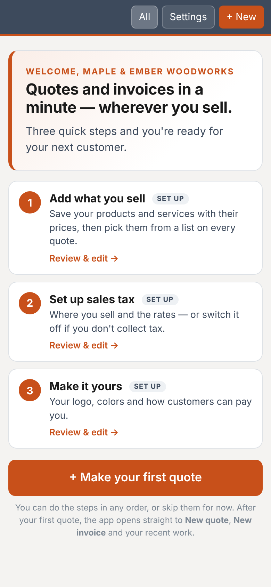
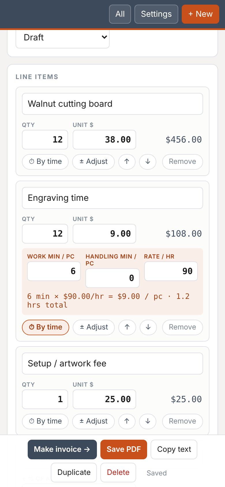
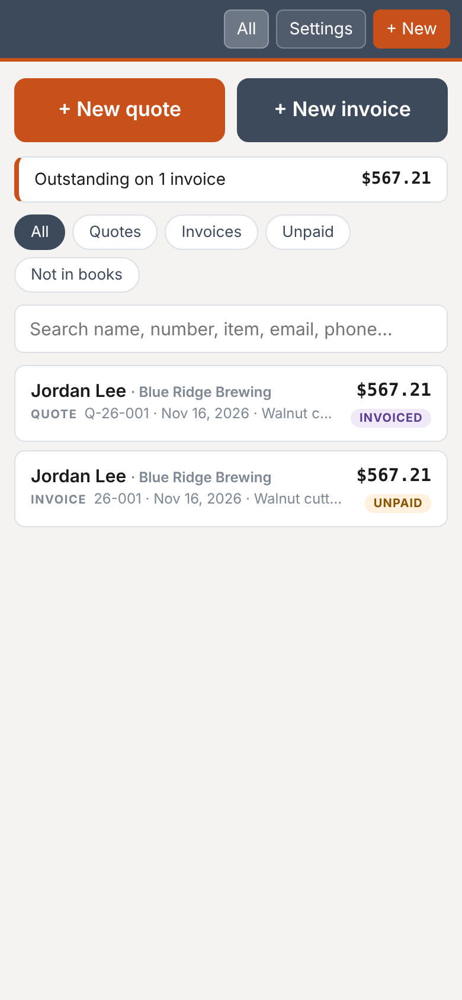
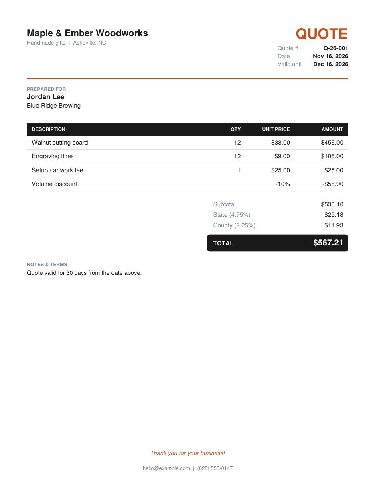

# Quick Quote

**Fast, simple quotes and invoices for makers, trades and side businesses — built in your own Claude account.**

Quick Quote is a free, open-source quote and invoice app. You attach two files to a Claude chat, describe your business in your own words, and Claude sets the app up for you in about five minutes. It works on your phone at a craft show or job site and on your computer at home, and your quotes and invoices stay private in your own Claude account.

  
  
  

*Screenshots use a made-up business.*

---

## What it does

- **Quotes in a minute** — pick from your saved products & services; price by the item, by the hour, or by time per piece; add discounts or rush fees as a percentage.
- **Quote → invoice in one tap**, with matching numbers (Q-1001 → 1001). Optionally put the year in front (Q-26-001 → 26-001), starting again at 001 every January.
- **Sales tax** — on or off, added on top or included in the price, several tax locations, each rate shown on its own line.
- **Deposits** — ask for one on just the quotes that need it.
- **Clean PDFs** with your logo and colors, and an optional clickable pay link and QR code on unpaid invoices.
- **Optional payment tracking** — mark invoices paid or partly paid, if you want to.
- **Exports for your bookkeeping** (CSV): sales summary by week or month, sales tax summary, invoice list, and a register of every number used.
- **Backup and restore**, plus cleanup of old records when you're ready.

## What you need

- **A paid Claude plan** — Pro, Max, Team or Enterprise. Quick Quote saves your data in your Claude account, and that saved-data feature isn't part of the free plan. (On the free plan the app still opens, but it can only save in one browser on one device, and it says so on screen.)
- **Code execution and file creation** switched on in Claude's **Settings → Capabilities** (on Team and Enterprise, your admin controls this).
- Claude on the web, the desktop app, or your phone's web browser.

## Get started

1. Download **`Quick-Quote-v1.0.zip`** from the [latest release](../../releases/latest) and unzip it. Inside are two files: `QUICK-QUOTE.md` (the guide) and `quick-quote.html` (the app).
2. Open a **new chat** in Claude and **attach both files**.
3. Type: **Build my Quick Quote**

Claude asks about your business, suggests a starting setup (your products & services and sales tax), adjusts it with you, then builds your app, pins it to your Claude sidebar and gives you a link. Everything it sets up is just a head start — you can change all of it later in the app's Settings.

**Day to day:** the app opens straight to **+ New quote** and **+ New invoice**, with your recent work underneath. Bookmark it on your computer, or use **Add to Home Screen** on your phone.

**Updating later:** attach the new version's files in a chat and type **Update my Quick Quote**. Your quotes, invoices and settings are kept.

---

## Is it safe? What's inside

Both files are plain text, so you can read them before you use them — that's the point of publishing them here.

- **`quick-quote.html`** — the whole app: one web page (HTML, CSS and JavaScript), no build step, nothing hidden or minified except the two libraries below.
- **`QUICK-QUOTE.md`** — plain-English instructions that tell Claude how to set the app up. It lets Claude do four things: build the app as an artifact in *your* account, fill in your starting settings, **ask your permission** before switching on the app's three permissions, and pin the app to your sidebar. It tells Claude not to change the app's code.

**Where your data goes.** Your quotes, invoices and settings are stored in your own Claude account, in storage that only you can read. The app has no server, no analytics and no tracking, and it doesn't send your data anywhere. Nobody else — including us — can see it.

**The three permissions it asks for:**

| Permission | Why |
|---|---|
| Save data | Keeps your quotes and invoices in your Claude account. |
| Know it's you | Opens *your* data on any device you're signed in on. |
| Download files | Saves PDFs, spreadsheets and backups to your device. |

**Outside connections.** The page loads two open-source libraries from the jsDelivr CDN, pinned to exact versions and protected with [integrity hashes](https://developer.mozilla.org/en-US/docs/Web/Security/Subresource_Integrity) — if either file is ever altered, the browser refuses to run it:

- [jsPDF](https://github.com/parallax/jsPDF) 2.5.1 (MIT) — builds the PDFs
- [qrcode-generator](https://github.com/kazuhikoarase/qrcode-generator) 1.4.4 (MIT) — draws the pay-link QR code

The only other link is a plain link you'd have to tap yourself: Settings mentions **Scan-n-Pay**, a separate app from the same maker (see below). That link carries a referral tag (`utm_source=quickquote`) so we can see a visit came from Quick Quote — nothing is sent unless you click it.

### Verify the files

`SHA256SUMS.txt` lists a SHA-256 checksum for each file. A matching checksum proves your copy is exactly the one published here.

- **macOS / Linux:** `shasum -a 256 QUICK-QUOTE.md quick-quote.html Quick-Quote-v1.0.zip` and compare with `SHA256SUMS.txt` (on Linux, `sha256sum -c SHA256SUMS.txt` checks them for you).
- **Windows (PowerShell):** `Get-FileHash .\quick-quote.html` (and the same for the other files), then compare.

---

## Good to know

- **Sales tax:** Claude looks up your local rates and shows where it found them, but rates and rules change — check them with your state or local tax authority. Quick Quote is a tool, not tax or accounting advice.
- **Your records:** download a backup now and then (**Settings → Your data**).
- **Provided as-is:** this is a free tool, offered without warranty (see the license). Bug reports and ideas are welcome in [Issues](../../issues).

## Who made this

Quick Quote is made by **Energy Etch LLC**, a small veteran-owned laser engraving business in Virginia Beach, VA, that built it for its own quotes and decided to share it. We also make **[Scan-n-Pay](https://scannpay.me/intro)**, an app that puts several payment options behind one link and QR code. Quick Quote mentions it once, in the payment settings, as an option — it works with any payment link, and you never need Scan-n-Pay to use it.

## License

[MIT](LICENSE) — free to use, change and share. Third-party libraries keep their own MIT licenses.
